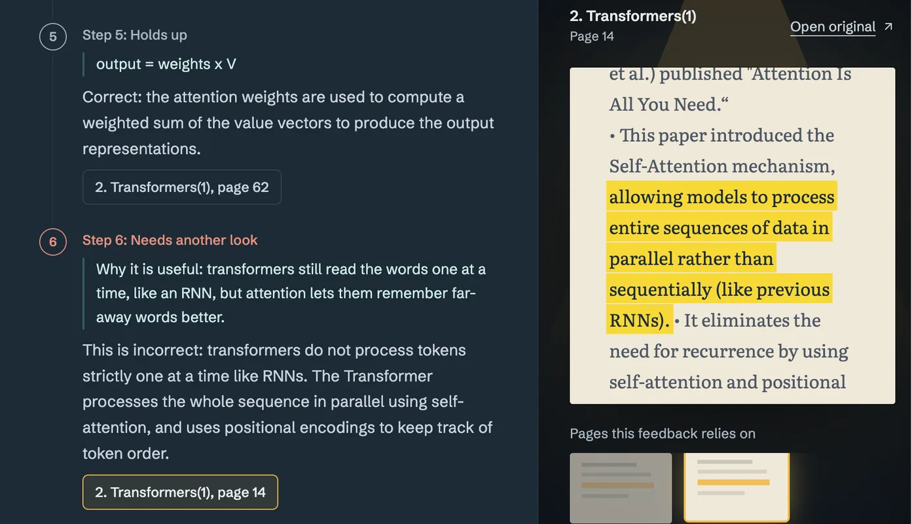
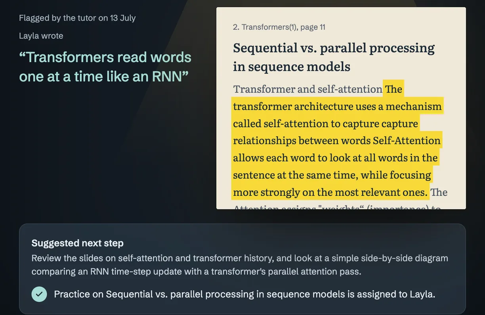

<p align="center">
  <picture>
    <source media="(prefers-color-scheme: dark)" srcset="docs/brand/edubridge-wordmark-for-dark.svg">
    
  </picture>
</p>

<p align="center">
  A course tutor that only answers from the teacher's own material,<br>
  and lights up the exact line it used.
</p>

<p align="center">
  <a href="https://github.com/Shaadi619/edubridge-ai/actions/workflows/ci.yml"></a>
</p>

---

Students ask questions, take quizzes and upload their working. Every answer and correction comes with the page of the course it was checked against, so a student can see for themselves why it's right. Teachers see who is stuck, on what idea, in the student's own words, beside the slide that covers it.





<sub>Screens from a real university course on transformers, built from the lecturer's slides. The student's name is changed.</sub>

## What it does

**For students**

- **Ask about the course.** Answers come only from the course material. If the material doesn't cover a question, it says so instead of guessing.
- **Practise with quizzes.** Short quizzes written from the same material, with the next one prepared in the background. Each explanation shows the line it was checked against.
- **Show your work.** Upload a photo or PDF of your working; each step is checked and any correction points to the line it relies on.
- **Explain it back.** Put an idea in your own words, typed or spoken, and find out what's right and what's missing.

**For teachers**

- **Who needs you today.** Students flagged by the tutor, quizzes and follow-up checks, grouped by student, with their own words beside the course passage.
- **Common mistakes.** Misunderstandings across the class, which ones go together, and whether they've been put right.
- **Course check.** Which topics the material covers, which have quiz questions, and what to add next.
- **Follow-ups.** Assign practice or draft a message with AI; nothing reaches a student without the teacher's say-so.

## How it stays honest

- Retrieval is limited to the active course. Citations point to stored pages, not to file names the model made up.
- A quote is lit only if it is found in the stored page text. Quotes that don't match are dropped, and the feedback says so.
- Quiz answer keys are checked independently against the course before a quiz is published.
- A suspected misunderstanding from uploaded work goes on a student's record only after the teacher agrees.

More in [docs/architecture.md](docs/architecture.md).

## Built with

| Part | Stack |
| --- | --- |
| Web app | React 18, Vite, TypeScript, Tailwind CSS 4 |
| API | FastAPI (Python 3.12), httpx, Pydantic |
| Data | Supabase: Postgres with row-level security, pgvector, Storage, Auth |
| AI | Azure OpenAI or any OpenAI-compatible endpoint, in two tiers by task |

## Repository layout

```
apps/web               React front end
apps/api               FastAPI back end (routers, AI prompts and contracts, tests)
supabase/migrations    Database schema and row-level security, applied in order
docs                   Architecture, authentication, roadmap and brand assets
```

## Running it locally

You need Node 22, Python 3.11 or later, a Supabase project and an Azure OpenAI (or OpenAI-compatible) deployment.

1. **Database.** Run the SQL files in `supabase/migrations` in order, then follow [docs/authentication.md](docs/authentication.md) to set up sign-in.
2. **Settings.** Copy `.env.example` to `.env` and `apps/web/.env.example` to `apps/web/.env`, and fill in your keys. Keys stay on the server; the browser only gets the Supabase anon key.
3. **API**

   ```bash
   cd apps/api
   python -m venv .venv && source .venv/bin/activate
   pip install -e '.[dev]'
   uvicorn app.main:app --reload
   ```

   It runs at `http://localhost:8000`; `GET /api/v1/health` checks it's up.

4. **Web app**

   ```bash
   cd apps/web
   npm install
   npm run dev
   ```

   Open `http://localhost:5173`.

## Checks

CI runs on every pull request and every push to `main`:

```bash
# apps/api, inside the virtual environment
python -m pytest -q

# apps/web
npm run typecheck && npm test && npm run build
```

The tests use placeholder settings and mocked AI providers, so they need no real keys. The SQL regression in `apps/api/tests/sql/` runs separately against a disposable database with all migrations applied.

## Status

EduBridge runs end to end with real courses. Before it goes online it still needs usage limits on AI calls, background work that survives a restart, a security review and a deployment. See the [roadmap](docs/product-roadmap.md).
