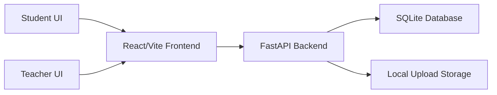
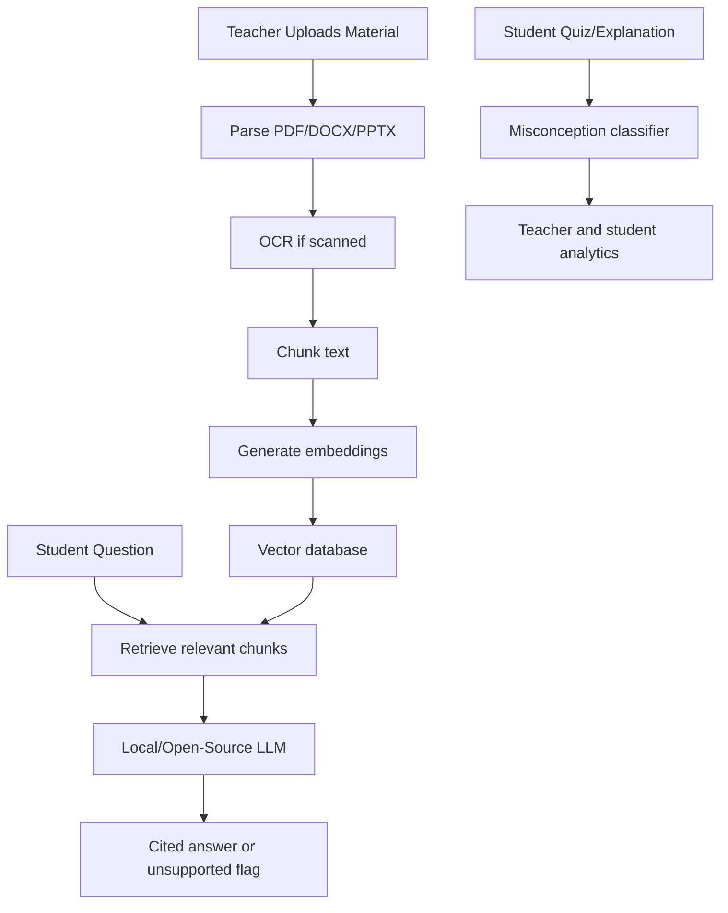

# EduBridge AI Architecture

## Goal

EduBridge AI helps teachers understand why students are confused, not only whether an answer is right or wrong.

## Core Roles

Teacher:

- Creates courses.
- Shares class codes.
- Approves enrollment requests.
- Uploads course materials.
- Reviews student progress and misconceptions.

Student:

- Joins courses using class codes.
- Waits for teacher approval.
- Asks course-grounded questions.
- Takes adaptive quizzes.
- Reviews weak topics and feedback.

## Current System

## Planned AI System

## Recommended Technical Defaults

- Use SQLite while prototyping.
- Move to PostgreSQL for production.
- Start with a custom RAG pipeline before adding LangChain or LlamaIndex.
- Use Ollama for early local LLM experiments.
- Keep endpoint response contracts stable while improving internals.

## First Subject Scope

English:

- Reading comprehension
- Thesis statements
- Topic sentences
- Paragraph structure
- Evidence use
- Grammar accuracy
- Essay coherence
- Inference
